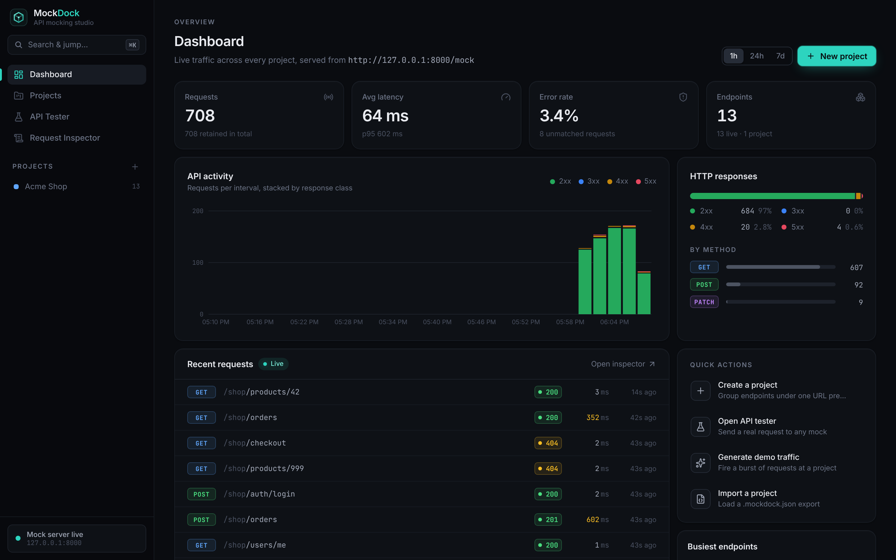
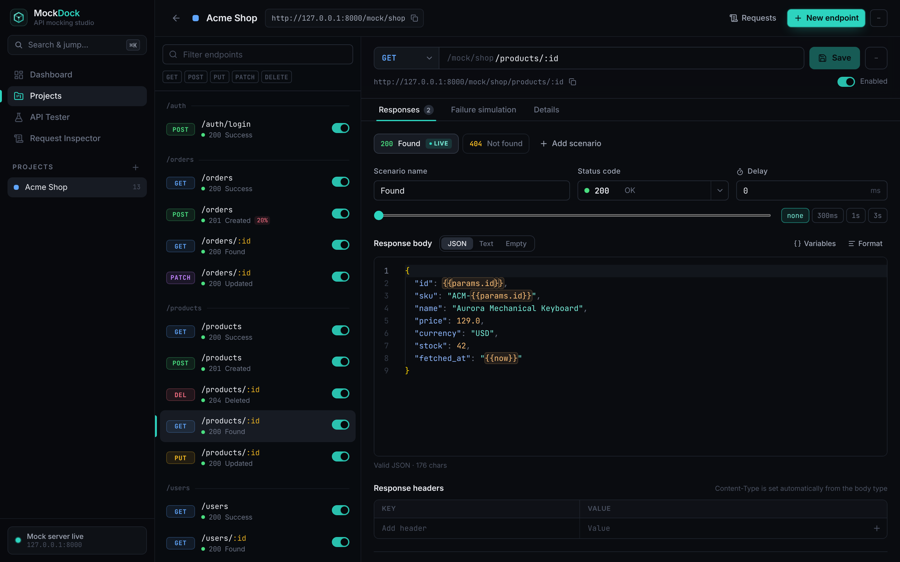
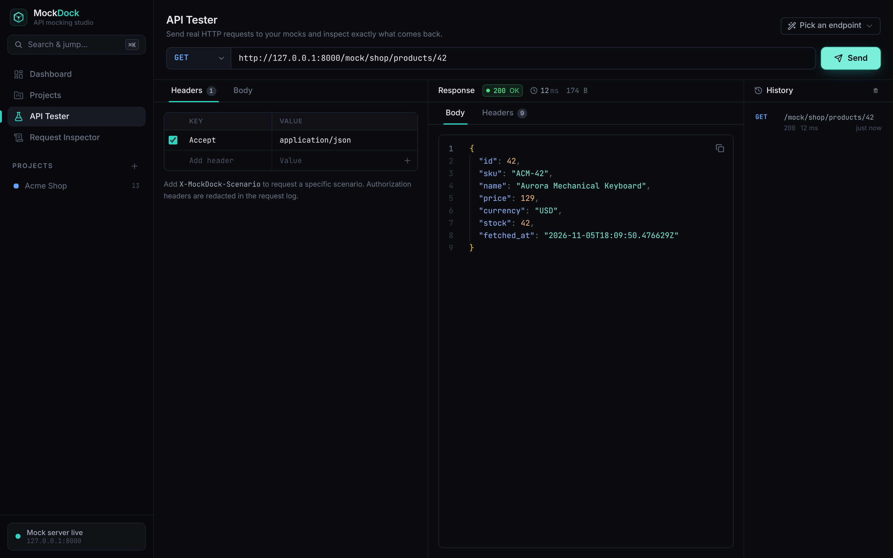
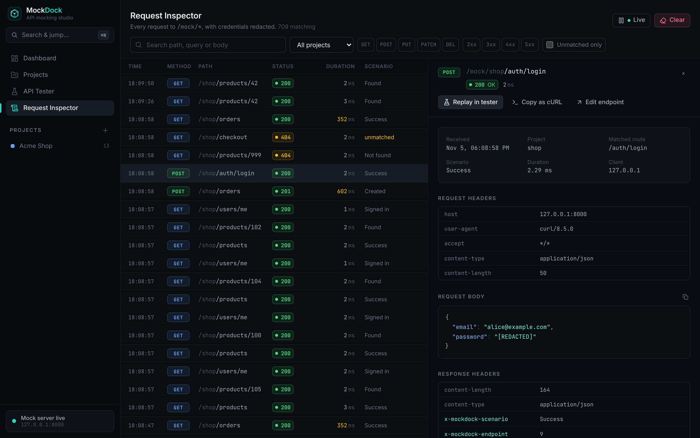
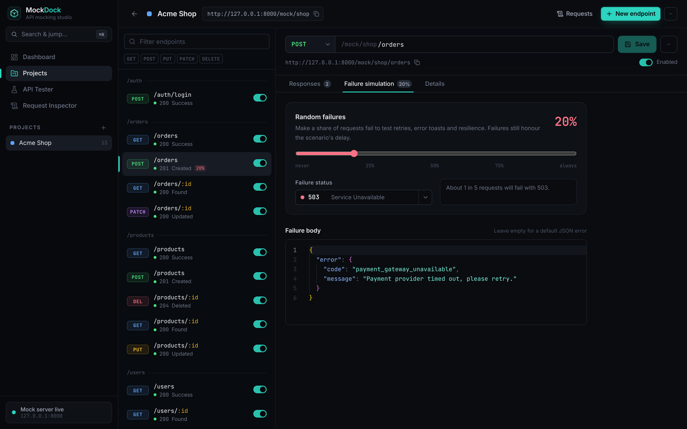

# MockDock

**A local-first API mocking and debugging studio.** Define fake REST endpoints in a polished UI, and MockDock serves them right away from a real HTTP server. You can simulate slow networks and failures, switch between response scenarios, and inspect every request your app sends.

```
GET http://127.0.0.1:8000/mock/shop/products/42
→ 200 OK  {"id": 42, "sku": "ACM-42", "name": "Aurora Mechanical Keyboard", …}
```

No backend code, no cloud account, and no internet connection needed. Everything lives in one SQLite file on your machine.



---

## Features

| Area | What you get |
| --- | --- |
| **Dashboard** | Request volume, average and p95 latency, error rate, an activity chart stacked by status class, method breakdown, busiest endpoints, a live feed of recent requests and quick actions (including "generate demo traffic"). |
| **Projects** | Create, rename (name and URL slug), delete, **export to JSON** and **import from JSON**. Each project gets its own namespace: `/mock/<slug>/…`. |
| **Endpoint builder** | `GET` `POST` `PUT` `PATCH` `DELETE`; paths with route parameters (`/users/:id` or `/users/{id}`); status codes; Monaco JSON editor with live validation; response headers; per-scenario delays; enable/disable; duplicate (also as another method). |
| **Scenarios** | Up to 20 named responses per endpoint (for example *Success*, *Not found*, *Slow*). One is **live**. Any other can be requested on demand with `X-MockDock-Scenario: <name>` or `?__scenario=<name>`. |
| **Templating** | `{{params.id}}`, `{{query.page}}`, `{{body.items.0.sku}}`, `{{headers.x-user}}`, `{{now}}`, `{{timestamp}}`, `{{uuid}}`. These are lookups only, with no code execution. |
| **Error simulation** | Artificial delays (0–30 s), any 2xx–5xx status, empty bodies, and **random failures** with a configurable probability and status/body. |
| **Live mock server** | Real FastAPI routes. Configuration is read on every request, so edits apply instantly without a restart. Unknown projects and routes return 404, wrong methods return `405` with an `Allow` header, and disabled endpoints return 404 with a clear error code. |
| **API tester** | Method, URL, headers (toggleable), JSON body, `⌘/Ctrl+Enter` to send. Shows status, latency, size, pretty-printed body and response headers, plus request history and a "Pick an endpoint" shortcut. |
| **Request inspector** | Live-updating log with search (path, query, body), filters (project, method, status class, unmatched), full request/response detail, **Replay in tester**, **Copy as cURL**, and clear history. Credentials are **redacted** before storage. |
| **Sample project** | *Acme Shop*: 13 endpoints across products, users, auth and orders, seeded on first start. |
| **Polish** | Dark theme with its own visual identity, ⌘K command palette, keyboard shortcuts, tooltips, skeleton loaders, empty states, toasts, a responsive layout down to phone width, and unsaved-change guards. |

---

## Technology stack

- **Backend:** Python 3.10+, FastAPI, SQLAlchemy 2, Pydantic 2, SQLite (WAL mode), Uvicorn
- **Frontend:** React 18, TypeScript (strict), Vite, Tailwind CSS v4, TanStack Query, React Router, Radix UI primitives, Monaco Editor (bundled locally), Lucide icons, Sonner toasts
- **Testing:** pytest + FastAPI TestClient; Vitest + Testing Library; a live-server smoke test; a Playwright browser walkthrough

---

## Architecture

```
┌──────────────────────────── Browser ────────────────────────────┐
│  React UI (Vite dev server :5173, or built files served by API) │
│   • TanStack Query → /api/...   (management)                    │
│   • API tester     → /mock/...  (real mock traffic)             │
└───────────────┬─────────────────────────────────┬───────────────┘
                │ /api/*                          │ /mock/*
┌───────────────▼─────────────────────────────────▼───────────────┐
│ FastAPI app (127.0.0.1:8000)                                    │
│  app/api/*        CRUD for projects, endpoints, logs, stats     │
│  app/services.py  business rules (duplicates, import/export…)   │
│  app/mock/        matcher → scenario → delay/failure → render   │
│                   → log (redacted)                              │
│  app/models.py    SQLAlchemy models  ──►  SQLite (data/*.db)    │
└─────────────────────────────────────────────────────────────────┘
```

- **Two separate namespaces.** `/api/*` is the management API and `/mock/{project}/*` is the mock server. The mock router is a catch-all *inside its own prefix only*, so a user-defined mock route can never shadow or reach an admin route. There's a test for this: `test_mock_namespace_cannot_reach_admin_api`.
- **No restart needed.** Every mock request reads the project's endpoints from SQLite, so a save in the UI takes effect on the next request.
- **Route matching** (`app/mock/matcher.py`) is a small pure-function module. The most specific route wins: `/users/me` beats `/users/:id`.
- **Schema** comes from the SQLAlchemy models (`create_all`) and is versioned with SQLite's `PRAGMA user_version`. There's a migration hook in `app/db.py`.

More detail, written for newcomers, is in **[HANDOVER.md](HANDOVER.md)**. Verification results are in **[docs/ENGINEERING_REPORT.md](docs/ENGINEERING_REPORT.md)**.

```
MockDock/
├── backend/
│   ├── app/
│   │   ├── main.py          app factory: CORS, routers, static UI
│   │   ├── config.py        settings from MOCKDOCK_* env vars
│   │   ├── db.py            engine, sessions, schema init
│   │   ├── models.py        Project, Endpoint, Scenario, RequestLog, Meta
│   │   ├── schemas.py       request/response validation (Pydantic)
│   │   ├── services.py      project/endpoint logic, import/export
│   │   ├── seed.py          the Acme Shop sample
│   │   ├── errors.py        uniform {"error": {...}} responses
│   │   ├── api/             projects, endpoints, logs, stats, system routers
│   │   └── mock/            matcher, templating, redaction, server
│   └── tests/               pytest suite (79 tests)
├── frontend/
│   └── src/
│       ├── api/             typed client + React Query hooks
│       ├── components/      UI kit, editor, palette, dialogs, chart
│       ├── pages/           Dashboard, Projects, Project, Tester, Inspector
│       ├── lib/             helpers (http, template, tester, format…)
│       └── test/            Vitest suites
├── scripts/                 dev.sh, live_smoke.py
├── e2e/ui-workflow.cjs      Playwright browser walkthrough
└── Makefile
```

---

## Setup

**Requirements:** Python 3.10+ and Node.js 20+ (developed with Python 3.13 and Node 22).

```bash
git clone <this repo> && cd MockDock
make install          # creates backend/.venv, pip installs, npm installs
```

<details><summary>Without make</summary>

```bash
python3 -m venv backend/.venv
backend/.venv/bin/pip install -r backend/requirements-dev.txt
cd frontend && npm install
```
</details>

## Running

**Development** (hot reload for both sides):

```bash
make dev
# UI:          http://127.0.0.1:5173
# Mock server: http://127.0.0.1:8000/mock/<project>/...
# API docs:    http://127.0.0.1:8000/api/docs
```

**Single-process "production" mode** (build the UI once, then FastAPI serves everything):

```bash
make start            # → open http://127.0.0.1:8000
```

### Configuration

All settings are optional environment variables:

| Variable | Default | Meaning |
| --- | --- | --- |
| `MOCKDOCK_HOST` | `127.0.0.1` | Bind address. It's localhost-only by default; change it only if you understand the exposure. |
| `MOCKDOCK_PORT` | `8000` | Port for API + mock server |
| `MOCKDOCK_DB_PATH` | `backend/data/mockdock.db` | SQLite file |
| `MOCKDOCK_CORS_ORIGINS` | `http://localhost:5173,http://127.0.0.1:5173` | Comma-separated origins allowed to call the server from a browser |
| `MOCKDOCK_SEED_SAMPLE` | `true` | Seed Acme Shop into a brand-new database |
| `MOCKDOCK_MAX_DELAY_MS` | `30000` | Hard cap on simulated latency |
| `MOCKDOCK_LOG_RETENTION` | `5000` | Number of request-log rows to keep |

If your own web app (say on `http://localhost:3000`) calls the mocks from the browser, add its origin to `MOCKDOCK_CORS_ORIGINS`.

To reset everything, stop the server and delete `backend/data/mockdock.db`. The sample is re-seeded on next start.

---

## Sample API requests

These work right after the first start, using the seeded Acme Shop project:

```bash
# List products (200, with Cache-Control and X-Total-Count headers)
curl -i http://127.0.0.1:8000/mock/shop/products

# Route parameter templating → {"id": 42, "sku": "ACM-42", ...}
curl http://127.0.0.1:8000/mock/shop/products/42

# Static route beats parameter route
curl http://127.0.0.1:8000/mock/shop/users/me

# POST with a JSON body — fields are echoed via {{body.name}} / {{body.price}}
curl -X POST http://127.0.0.1:8000/mock/shop/products \
     -H 'Content-Type: application/json' -d '{"name": "Desk Lamp", "price": 39}'

# Ask for a specific scenario without changing the live one
curl -i http://127.0.0.1:8000/mock/shop/products/7 -H 'X-MockDock-Scenario: Not found'
curl -i 'http://127.0.0.1:8000/mock/shop/products?__scenario=Slow%20network'   # 2.5 s delay

# Random failures: POST /orders fails ~20% of the time with 503
for i in $(seq 10); do curl -s -o /dev/null -w '%{http_code}\n' -X POST \
  http://127.0.0.1:8000/mock/shop/orders -H 'Content-Type: application/json' -d '{"items": []}'; done

# Errors MockDock itself returns
curl -i http://127.0.0.1:8000/mock/shop/nope        # 404 route_not_found
curl -i -X DELETE http://127.0.0.1:8000/mock/shop/users   # 405 + Allow: GET
```

Management API example (the full OpenAPI docs are at `/api/docs`):

```bash
curl -X POST http://127.0.0.1:8000/api/projects -H 'Content-Type: application/json' \
     -d '{"name": "Payments", "slug": "payments"}'
curl -X POST http://127.0.0.1:8000/api/projects/2/endpoints -H 'Content-Type: application/json' -d '{
  "method": "GET", "path": "/charges/:id",
  "scenarios": [{"name": "OK", "status_code": 200, "body": "{\"id\": \"{{params.id}}\", \"paid\": true}"}]
}'
curl http://127.0.0.1:8000/mock/payments/charges/ch_123
```

---

## Testing

```bash
make test       # pytest (backend) + tsc type-check + vitest (frontend)
make smoke      # boots a real uvicorn on a temp DB and checks the 12 core scenarios over HTTP, incl. restart persistence
make e2e        # Playwright walkthrough in a real browser (start the app first with `make dev` or `make start`)
```

| Suite | What it covers |
| --- | --- |
| `backend/tests` (79 tests) | path parsing/matching and specificity, templating, redaction, project/endpoint CRUD and validation, duplicate-route detection, import/export round trip, live mock behaviour (JSON, POST bodies, headers, delays, error scenarios, random failures, empty bodies, HEAD/OPTIONS, 404/405/413, disabled endpoints), namespace isolation, CORS policy, logging and retention, stats, persistence across app restarts, static UI serving (no path traversal), and a check that every seeded sample endpoint answers correctly |
| `frontend/src/test` (36 tests) | path validation, template-aware JSON validation, formatting and error positions, tester URL routing, cURL generation, API client error handling, and components (badges, key/value editor, scenario editor, endpoint list) |
| `scripts/live_smoke.py` | the 12 verification scenarios against a real server process |
| `e2e/ui-workflow.cjs` | create project → create endpoint in Monaco → call from tester → edit (live) → 100% failure simulation → inspector → delete |

---

## Screenshots

These were captured from the running app with real traffic from the sample project.

| | |
| --- | --- |
|  |  |
| Endpoint editor with scenarios and template highlighting | API tester |
|  |  |
| Request inspector with redacted credentials | Random-failure simulation |

---

## Security notes

- The server binds to **127.0.0.1** by default, and CORS only allows the local UI origins.
- Mock routes are confined to `/mock/{project}/…`. They can't override `/api` and are never proxied anywhere.
- Templating is a fixed set of data lookups, and nothing is ever evaluated as code.
- `Authorization`, `Cookie`, API-key and similar headers are redacted before they're written to the log. So are JSON fields such as `password`, `token` and `secret`, in both requests and responses.
- Response headers are validated: no CR/LF injection, and no overriding of `Content-Length`, `Transfer-Encoding` and so on.
- Request bodies over 1 MB are rejected with 413, and delays are capped.
- There's no authentication: MockDock is a single-user local tool. **Don't expose it to a network you don't trust.**

## Limitations

- Single user, no auth or multi-user collaboration, and no HTTPS (it's meant for localhost).
- Matching is on method and path only. You can't yet match on query, header or body conditions. Use scenarios plus the `X-MockDock-Scenario` header instead.
- The mocks are stateless: a `POST` doesn't add an item that a later `GET` returns.
- Templating covers simple lookups only, with no loops or conditionals.
- Only the most recent `MOCKDOCK_LOG_RETENTION` requests are kept, and the inspector lists up to 500 at a time.
- The live inspector and dashboard poll every 2–4 s rather than using websockets.
- Delays are capped at 30 s, and binary response bodies aren't supported (text and JSON only).
- The unsaved-changes guard covers switching endpoints and closing the tab, but not every sidebar link.

## License

MIT
